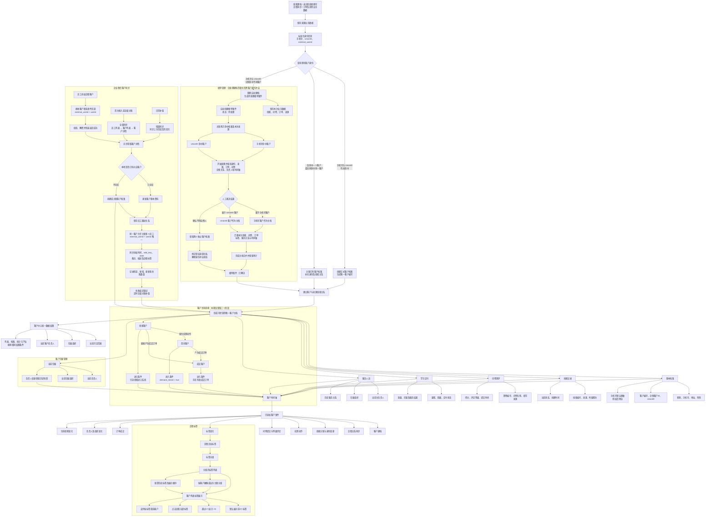
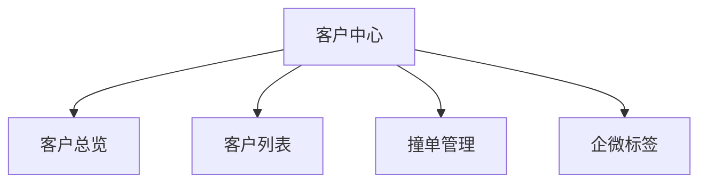
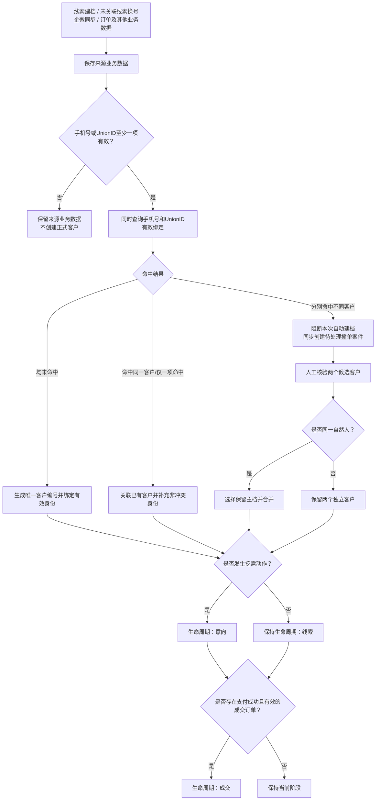

# 合数BOSS V1.0——客户中心详细需求

| 文档属性 | 内容 |
|---|---|
| 所属项目 | 合数BOSS重构项目 |
| 所属版本 | V1.0 |
| 一级菜单 | 客户中心 |
| 文档版本 | V1.24 |
| 文档状态 | 产品需求评审稿 |
| 更新日期 | 2026-10-21 |

> 客户生命周期、客户360°档案、服务人员流转及详细数据模型以 [合数BOSS客户360°档案与生命周期需求](./合数BOSS客户360档案与生命周期需求文档.md) 为专项基线，本文负责客户中心各菜单页面和操作要求。

> **V1.14 历史补充：**客户生命周期仅保留“线索、意向、成交”三个阶段：引流线索进入即建立客户经营档案并标记为线索客户；发生可追溯挖需动作后转为意向客户；存在支付成功且有效的成交订单后转为成交客户。客户列表“建档时间”统一为“客户创建时间”；基本档案展示昵称、手机号预览、客户地址、性别和客户编号，不展示企微客户ID与UnionID。身份冲突处理以 V1.24 最新规则为准。

> **V1.15 当前生效补充：**客户列表中的“客户创建时间”统一更名为“客户添加时间”，继续使用客户主档的 `created_at` 字段，不迁移、不重算历史数据。该调整仅作用于客户列表展示及关联客户选择场景；客户总览的统计筛选仍沿用“客户创建时间”口径。

> **V1.17 当前生效补充：**标签管理只保留标签库和标签组，来源固定为系统、企业微信，两类标签在BOSS侧均为只读；系统标签由业务事实产生，企业微信标签通过同步进入，不提供新增、编辑、启停或删除标签入口。标签组支持新增、编辑、启停，可包含当前标签库任意有效标签，不配置标签对象、维护组织或排序；保存后的标签组及标签关联必须稳定保留。后文与本补充冲突的旧表述均不再生效。

> **V1.18 当前生效补充：**标签状态枚举仅保留“启用、停用”，“已同步”不再作为状态；同步成功只作为同步操作结果提示。标签ID由系统生成且全局唯一，生成后不可修改、回收或复用。标签管理页面及需求范围不提供标签日志或标签操作日志的展示入口。后文与本补充冲突的旧表述均不再生效。

> **V1.19 当前生效补充：**客户中心“标签管理”更名为“企微标签”，仅管理当前企业主体的企微企业标签和当前用户可见的企微个人标签，彻底移除系统标签来源。页面采用左侧标签分组、右侧标签列表，支持同步、新增分组、批量新增标签、编辑和删除；企微返回的 `external_tag_id` 为标签ID事实来源。后文与本补充冲突的旧表述均不再生效。

> **V1.20 当前生效补充：**企微标签页面移除旧顶部组合筛选，以左侧分组名称搜索和右侧全局标签搜索替代；全局搜索覆盖当前类型全部分组。新增分组必须同时创建至少一个标签，分组名称与标签名称最长15字；分组行悬浮显示编辑、删除，非空分组禁止删除。详细规则以企微标签专项需求 V1.2 为准。

> **V1.21 当前生效补充：**企微标签分组行改为点击“…”展示编辑、删除；“新增分组”右侧“…”进入空分组批量删除模式。标签“使用客户”数量可跳转客户列表并自动带入标签筛选。客户列表移除标题下方“唯一身份、客户来源、添加方式”说明卡片，业务字段和校验规则不变。详细标签规则以企微标签专项需求 V1.3 为准。

> **V1.22 当前生效补充：**企微标签仅保留企微企业标签，移除企微个人标签入口、数据和切换逻辑。新增与编辑分组的适用部门均支持组织树多选，“全部部门”与具体部门互斥且至少选择一项；点击分组列表中的适用部门可直接进入编辑。详细规则以企微标签专项需求 V1.4 为准。

> **V1.23 历史补充：**客户列表“变更手机号”弹窗精简顶部说明；撞单管理状态仅保留待处理、已解决；列表新增命中类型并将候选命中信息合并为“命中人”，待处理处理人展示“--”，操作仅为待处理“开始处理”、已解决“查看结果”。人工裁决直接完成处理并进入已解决，不再设置处理中或单独领取环节。手机号变更的最终处理规则以 V1.24 为准。

> **V1.24 当前生效补充：**系统不提供人工新增客户入口。正式客户只能由线索建档、未关联客户的线索变更手机号、企业微信客户同步、订单或其他业务数据触发统一身份匹配后创建或关联。已关联客户的线索变更手机号只更新线索手机号，即使新号码属于其他客户，也不修改客户主手机号、不创建客户、不触发撞单；客户列表变更主手机号时，号码已属于其他客户则直接禁止并提示“当前手机号已存在客户，不允许修改！”。撞单仅在建档匹配过程中手机号命中客户 A、UnionID 命中客户 B 时生成。后文与本补充冲突的旧表述均不再生效。

## 客户中心整体流程图

## 1. 文档目标

客户中心以家长客户为唯一经营主体，统一管理客户身份、360°档案、当前归属、历史服务人、标签和SABC等级。客户中心不设置“跟进记录”“等级管理”“公海客户”或“商机管理”二级菜单：历史服务与互动信息在客户档案内聚合展示；客户等级在客户列表操作中编辑。撞单管理纳入 V1.0，用于处理手机号与 UnionID 分别命中不同客户的强身份冲突；公海和商机能力已取消，不纳入任何当前版本规划。

V1.0必须实现“一个家长一个客户主档、所有线索和业务关联同一客户编号、所有归属和阶段变化可追溯、冲突可裁决、误操作可恢复”。

## 2. 核心口径

- 家长是客户、系统用户、课程学员和服务权益归属人；
- 孩子不是客户、用户或独立学员，仅作为家长名下附属对象；
- 手机号或UnionID任一有效即可创建或关联唯一客户；每个有效客户主档最多保存一个主手机号；
- 两种身份均缺失时只保留线索，不得转为正式客户；
- 订单、权益、交付、归属和生命周期归属于家长客户；
- 问卷、测评、诊断和课程匹配可选关联孩子作为业务背景；
- 任一时点每个客户只有一个有效主负责人，但可同时有一转、二转、班主任、规划师等不同服务角色。
- “首次来源”回答客户从哪个平台、渠道、店铺、商品或IP而来；“添加方式”只回答客户通过什么动作进入客户池，两者独立保存、独立筛选，禁止复用同一字段。

### 2.1 客户添加方式统一枚举

字典编码为 `customer_add_method`，V1.0 仅允许以下三个稳定值：

| 字典项值 | 页面文案 | 判定口径 |
|---|---|---|
| `LINK` | 通过链接添加 | 客户通过带参链接、落地页或可识别分享链接完成添加 |
| `BUSINESS_CARD` | 名片 | 客户通过员工名片或客户名片完成添加 |
| `QR_CODE` | 扫描二维码 | 客户扫描员工活码或其他可识别二维码完成添加 |

添加方式由客户首次成功进入客户池的业务事件写入。系统回调或来源业务能够识别时自动填写；系统不提供人工新增客户入口。该字段是稳定事实，后续再次扫码、点击链接或转介绍不自动覆盖；确需纠错必须具备编辑权限、填写原因并记录变更前后值。历史数据无法还原时显示“—”，不得用首次来源反推或批量伪造。

## 3. 范围与菜单

| 二级菜单 | 主要职责 | 优先级 |
|---|---|---|
| 客户总览 | 客户规模、生命周期、首次来源、添加方式、等级、归属和转化概览 | P1 |
| 客户列表 | 唯一客户、身份、添加方式、首次来源、360°档案、负责人、客户画像及等级编辑 | P0 |
| 撞单管理 | 手机号与 UnionID 跨档案命中时自动建案、证据核验、身份划归和审计 | P0 |
| 企微标签 | 企业微信企业标签、标签分组与同步 | P1 |

## 4. 客户身份与建档

### 4.1 创建与关联决策

### 4.2 身份规则

1. 手机号先做国家区号、空格、分隔符等标准化，UnionID按来源CorpID和应用上下文校验；
2. 原值加密保存，标准化哈希用于查重，不以明文建立普通索引；
3. 客户手机号采用单值主手机号模型：一个有效客户主档最多保存一个主手机号，不提供备用手机号、多个手机号或手机号数组；
4. 主手机号在所有未合并、未删除的有效客户中全局唯一，同一手机号不得同时绑定两个有效客户；
5. V1.0 中国大陆手机号按标准化后的11位号码校验；未填写手机号时必须存在有效UnionID，否则不得建档；
6. 新建或转客时手机号已命中客户，系统关联原客户，不重复创建；仅当手机号和UnionID分别命中不同客户时进入撞单管理；
7. 主手机号只能通过客户列表“变更手机号”维护。必须具备客户身份维护权限并重新执行格式与唯一性校验；新号码已属于其他客户时直接禁止修改，不生成撞单案件。旧手机号只进入身份变更历史与审计，不继续作为当前有效手机号参与查重；
8. 客户合并时目标主档只能保留一个经裁决确认的主手机号，从档手机号解除有效绑定并保留历史快照，不得将两个手机号并列写入目标客户；
9. 同一类型有效身份只能属于一个有效客户；
10. 客户编码由服务端生成、永久不变且不得复用；
11. 企微ExternalUserID、第三方平台ID和旧系统编号作为辅助身份或来源标识，不能单独绕过手机号/UnionID转客户条件；
12. 合并后原客户编码保留为历史别名，拆分依据原始身份、线索和审计关系恢复；
13. 身份新增、解绑、设为主身份、合并和拆分均为高风险操作并保存原因；系统不提供人工新增客户入口。

## 5. 页面详细需求

### 5.1 客户总览

展示客户总量、生命周期分布、SABC等级、首次来源、添加方式、归属组织、负责人、流失候选、成交和退款回退。顶部使用统一数据权限组件，并提供“全部授权数据/仅看我的数据、归属组织、当前客户负责人”组合筛选。业务筛选包含客户创建时间、首次来源、客户等级和添加方式；客户创建时间默认最近一个月。全部指标、分布和下钻明细必须继承权限、客户创建时间及业务筛选快照。

### 5.2 客户列表与360°档案

客户列表标题下方不展示“唯一身份、客户来源、添加方式”说明卡片，标题后直接进入筛选与列表区域；该展示调整不改变手机号、UnionID、首次来源和添加方式的业务定义及校验规则。

列表字段至少包含客户编号、客户名称、生命周期、SABC等级、手机号、客户标签、企微状态、添加方式、首次来源、负责人、归属组织、客户添加时间和操作。右上角只展示齿轮设置图标，悬浮提示“字段设置”，不展示按钮文字；点击后打开可记忆的字段设置。客户编号、客户名称和操作为固定列且不可取消，其他字段允许自由选择。客户添加时间取客户主档 `created_at`，仅调整页面名称，不改变原有存储与历史数据。

客户列表提供生命周期、客户等级、添加方式和客户标签筛选。生命周期固定为线索客户、意向客户、成交客户；流失、无效、待分配、停用不作为客户生命周期。手机号默认脱敏，旁边提供眼睛图标授权预览并记录审计。

客户标签列最多直接展示2个标签，超过2个显示“+N”；点击打开全部标签弹窗，按标签来源分组展示，并保留添加BOSS人工标签操作。外部同步或系统规则标签不得被人工直接篡改。

客户列表提供添加方式筛选，支持 `LINK`、`BUSINESS_CARD`、`QR_CODE` 精确匹配。客户详情“基本档案”和360°来源信息同时展示添加方式与首次来源，避免把“扫描二维码”误当作渠道、把“抖店/有赞”误当作添加动作。系统不提供人工新增客户入口；客户由线索、企微同步、订单或其他业务数据触发建档时，继承来源业务已识别的添加方式。

客户列表、详情页、筛选项和导出表头统一使用“主手机号”单数口径，不展示“新建客户”按钮或人工新建弹窗。客户列表提供“变更手机号”，必须先校验后提交；弹窗顶部仅提示“系统会同时检查线索与客户主档；手机号未占用可直接变更”。新号码已属于其他有效客户时禁止保存并提示“当前手机号已存在客户，不允许修改！”，不进入合并或撞单流程。补录或换号仍必须执行身份维护权限、二次校验、幂等和完整日志要求。

**线索手机号与客户主手机号的独立维护规则**

- 未关联客户的线索变更为有效手机号后，必须执行统一身份匹配：手机号和UnionID均未命中时创建客户；任一身份命中客户A时关联客户A；两项分别命中客户A、客户B时阻断自动建档并生成撞单案件。
- 已关联客户的线索变更手机号时，操作对象仅为线索字段。新号码未占用、属于当前客户或属于其他客户，均只更新当前线索手机号，不修改关联客户主手机号、不改变客户编号和线索客户关系、不创建客户，也不生成撞单案件。
- 已关联客户的线索换号成功后，旧线索手机号进入字段变更历史，并记录操作人、操作时间、变更原因和前后值。页面提示：“当前线索已关联客户，本次仅更新线索手机号，不会修改客户主手机号。如需修改客户身份，请前往客户列表执行‘变更手机号’。”
- 客户列表变更主手机号时，操作对象仅为当前客户主档。新号码未占用时更新当前客户主手机号且客户编号保持不变；属于当前客户时视为未变化；属于其他客户时禁止修改并提示“当前手机号已存在客户，不允许修改！”。该入口不创建新客户，不批量覆盖历史线索手机号，也不触发客户合并或撞单。
- 客户主手机号成功变更后，旧号码解除当前有效绑定，仅保留在身份变更历史和审计记录；订单、问卷、标签、负责人和生命周期保持不变。

客户总览与客户列表统一提供“权限范围、全部授权数据/我的数据、客户归属组织、客户负责人”筛选。客户归属组织采用公司—部门—小组级联树，选择部门时包含直属员工和下属小组；客户负责人支持姓名和员工编号搜索，并随组织选择联动缩小候选范围。员工在职、停用及离职状态统一由员工管理处理，不作为客户筛选项。本人数据岗、小组管理岗、部门管理岗、公司数据管理岗和获批特别授权人员只能在有效数据岗位范围内筛选，页面不得返回超出授权范围的组织、员工、数量或汇总指标；业务角色只决定是否有客户页面及相关操作权限。

客户列表按当前客户负责人及当前责任组织查询，适合日常跟进和移交；客户总览中的新增、转化、成交等历史指标使用业务发生时负责人和组织快照，员工调岗或客户改派不得重写历史业绩。无负责人的客户仅在用户具有待分配、部门或公司级数据权限时展示，并可单独筛选。

当前客户档案页签为基本档案、线索记录、学习交付、服务人员、问卷测评和客户时间轴。基本档案展示昵称、手机号及授权预览、客户地址、性别和客户编号，不展示企微客户ID与UnionID；线索记录、问卷测评和客户时间轴分别展示对应模拟与业务记录，时间轴只追加不覆盖。

客户主表只保存当前核心状态和汇总，不把线索、订单、问卷答案、课程和服务人员历史堆叠为客户字段。

### 5.3 撞单管理（V1.0）

#### 5.3.1 进入条件与事务边界

同时满足以下条件时自动进入撞单管理：本次建档匹配携带有效手机号与有效 UnionID；手机号命中客户 A；UnionID 命中客户 B；且 A、B 为两个不同的有效客户主档。触发来源包括线索建立客户档案、未关联客户的线索变更手机号、企业微信客户同步、订单或其他业务数据进入。系统不提供人工建档；已关联客户的线索换号和客户列表变更主手机号均不触发撞单。

同一手机号和 UnionID 命中同一客户、只命中一个客户或只有一个有效强身份时不进入撞单。撞单产生时阻断本次自动建档或身份关联，但保留来源线索、订单、问卷及其他业务数据；必须在同一事务内冻结冲突身份覆盖与自动合并、创建撞单案件、关联本次来源并写入审计。未裁决前不得形成新的冲突有效绑定。

开放案件幂等键建议为 `hash(标准化手机号 + UnionID + 手机号命中客户ID + UnionID命中客户ID)`；同一冲突的重复回调、拉取或导入只能补充证据，不得重复建案。

#### 5.3.2 案件列表

列表展示案件编号、触发时间、本次进入身份、命中类型、命中人、触发来源、来源业务单号、处理状态和处理人。命中类型固定为手机号、UnionID；命中人根据命中类型展示对应客户编号、姓名、归属组织和负责人，不再分别设置“手机号命中”“UnionID命中”两列。支持按案件/客户/身份关键词、触发来源、状态和触发日期筛选。页面不展示风险等级，不提供风险筛选，也不把风险状态作为案件查询或处理条件。

状态固定为：`PENDING`（待处理）→ `RESOLVED`（已解决），不设置处理中。页面顶部只展示待处理和已解决数量。待处理案件的处理人展示“--”，操作列仅展示“开始处理”；已解决案件展示实际处理人，操作列仅展示“查看结果”。列表不再提供通用“详情”按钮；点击开始处理直接进入人工裁决，提交成功时记录处理人并更新为已解决。

#### 5.3.3 证据核验

处理页将两个候选客户并排展示，至少包含客户编号、姓名、手机号、UnionID、SABC等级、生命周期、当前归属组织/负责人、首次来源、创建时间、订单数量和问卷数量。差异字段突出显示，并展示来源线索/订单/企微事件及案件时间轴。手机号和 UnionID 明文仅对具备敏感身份查看权限的裁决人展示，每次查看写入访问日志。

#### 5.3.4 处理结论

| 结论 | 适用条件 | 系统动作 |
|---|---|---|
| 合并至手机号命中客户 | 核验为同一自然人，手机号主档更可信；页面按钮直接展示“合并至{客户姓名}” | 手机号命中客户作为主档，迁移 UnionID及从档业务关系，从档标记 `MERGED` |
| 合并至UnionID命中客户 | 核验为同一自然人，企微/UnionID主档更可信；页面按钮直接展示“合并至{客户姓名}” | UnionID命中客户作为主档，迁移手机号及从档业务关系，从档标记 `MERGED` |
| 确认不同自然人 | 身份采集或历史绑定错误，实际为两个人 | 两个客户均保留，记录核验依据并修正错误来源关系，不合并主档 |

裁决必须填写不少于 8 个字的理由，并确认已核验身份、订单和问卷记录。人工裁决说明固定为“被合并档案不物理删除，订单、问卷和操作历史全部保留”，不展示“服务人”文案。客户编号保留为历史别名，线索、订单、问卷、标签、服务关系、等级和审计记录迁移或建立指向主档的关系。合并前快照、字段冲突策略、操作人、时间和 `trace_id` 必须保存，用反向业务操作恢复，禁止直接删除或修改审计历史。

#### 5.3.5 权限与时效

撞单查看受两个候选客户数据范围的并集约束；撞单裁决为独立按钮权限。本人作为直接利益方时不得单独完成跨组织裁决；跨部门案件由公司数据管理岗或双方上级处理。待处理超过 24 小时进入超时提醒，超过 48 小时升级给客户主数据治理负责人。V1.0 暂不做自动裁决，任何权重或 AI 建议只能作为证据提示。

### 5.5 企微标签

企微标签仅维护企业微信企业标签，不再展示系统标签或企微个人标签。详细页面、校验、同步、权限和异常规则以《合数BOSS V1.0客户中心——企微标签需求文档》V1.4为准。

#### 5.5.1 页面入口与初始状态

- 页面入口：客户中心—企微标签，仅展示企微企业标签；默认选中第一个标签组。
- 页面采用左侧标签分组、右侧标签列表结构。

#### 5.5.2 查询与展示

- 左侧“新增分组”旁的搜索图标用于按标签分组名称实时筛选，关闭搜索后恢复全部分组。
- 右侧“搜索”进入全局搜索视图，在全部企微企业标签分组内，按标签名称、企微标签ID或标签分组名称实时模糊匹配；点击“取消”返回分组视图。
- 分组展示名称、适用部门和标签数量；当前分组列表展示标签名称、企微标签ID、使用客户、创建人、更新时间和操作。
- 全局结果额外展示所属标签分组和适用部门，操作必须定位结果所属分组；操作列固定右侧。“使用客户”数量可点击跳转客户列表，并自动带入标签名称和企微标签ID筛选。页面不展示标签来源列、旧顶部组合筛选或标签组类别筛选。

#### 5.5.3 标签ID生成及唯一性规则

- 标签ID以企业微信返回的 `external_tag_id` 为准，BOSS不得自行生成或修改。
- 本地以 `CorpID + external_tag_id` 作为来源唯一键；重复回调、补偿或手动同步更新原记录。

#### 5.5.4 同步企微

点击“同步企微”后创建补拉任务；按钮反馈同步成功、部分成功或失败及对应数量。同步幂等，不重复创建标签；单条失败不回滚其他成功标签，可重试失败项。“已同步”仅允许出现在结果提示中，不写入标签状态字段。

#### 5.5.5 标签组与标签维护

企业标签支持新增分组和在选中分组内批量新增标签。分组名称最长15字且同主体唯一；新增分组必须同时创建至少一个标签，支持逐个添加或按行批量新建。新增和编辑分组的适用部门均使用组织树多选，默认“全部部门”；“全部部门”与具体部门互斥，至少选择一项。分组列表多部门以顿号连接并可省略展示，点击适用部门直接打开编辑弹窗且不切换分组。分组行固定展示“…”入口，点击后显示编辑、删除；编辑回显名称和全部已选部门。非空分组禁止删除并提示先清空内容，空分组二次确认后可删除。“新增分组”右侧“…”进入批量删除模式，仅空分组可勾选，确认后批量删除。标签单次最多20个，名称以回车、换行、逗号或顿号分隔；单个名称最长15字，同批次及同组不可重复。编辑、删除同步至企业微信；部分失败不回滚成功项。

#### 5.5.6 权限、异常与边界

- 页面查看、分组新增、标签新增、编辑、删除和同步为独立权限点；标签分组按多个适用部门控制使用与编辑范围。
- 覆盖明细及导出沿用客户数据权限；无权客户不展示、不计入页面可见明细。
- 企业微信接口不可用时保留现有标签数据并提示同步失败，不改变原状态；来源标签被删除时将本地标签置为停用，不物理删除历史关系。
- 标签管理页面不提供标签日志、标签操作日志或同步历史的查询与展示入口。

### 5.6 客户等级（客户列表操作）

客户中心不设置独立“等级管理”菜单。客户列表展示当前等级及来源，并在单条客户操作中提供“编辑等级”；等级历史在客户档案内查看。

线索等级和客户等级共用字典 `lead_customer_grade`，可配置值为 S、A、B、C；“未定级”是系统保留状态，不作为可配置业务等级。字典只维护稳定枚举，问卷评分条件、分值区间、优先级和版本继续在线索配置—等级规则中维护。

新客户首次建档时复制来源线索的当前有效等级，并记录来源线索、评级来源、规则版本或人工记录及继承时间；命中存量客户时不得覆盖存量等级。客户建档后，线索等级与客户等级分别维护：客户侧人工改级必须具备权限、选择 S/A/B/C、填写原因并保存变更前后值、操作人和时间；不反向修改来源线索，后续线索改级也不得自动覆盖客户等级。详见《[合数BOSS V1.0——线索中心需求文档](./合数BOSS V1.0线索中心需求文档.md)》第 5.4.6 节。

## 6. 客户生命周期

V1.0生命周期仅为线索客户、意向客户和成交客户。引流线索进入即自动保存并建立客户经营档案，生命周期为线索；发生可追溯挖需动作后转为意向；存在支付成功且有效的成交订单后转为成交。其他状态不新增生命周期阶段。

客户生命周期、线索状态、SABC等级、订单状态和交付状态必须分开维护。

## 7. 核心数据模型

| 数据域 | 核心实体 |
|---|---|
| 客户主数据 | `CUSTOMER`（含 `add_method`）、`CUSTOMER_IDENTITY`、`CUSTOMER_ACCOUNT`、`CHILD_PROFILE` |
| 线索关系 | `LEAD_CUSTOMER_RELATION` |
| 生命周期与归属 | `CUSTOMER_LIFECYCLE_HISTORY`、`CUSTOMER_OWNER_RELATION` |
| 跟进标签等级 | `FOLLOW_UP_RECORD`、`TAG_DEFINITION`、`TAG_GROUP`、`TAG_GROUP_RELATION`、`EXTERNAL_TAG_MAPPING`、`CUSTOMER_TAG_RELATION`、`CUSTOMER_GRADE_HISTORY` |
| 撞单 | `CUSTOMER_IDENTITY_COLLISION_CASE`、`CUSTOMER_IDENTITY_COLLISION_EVIDENCE`、`CUSTOMER_IDENTITY_COLLISION_AUDIT` |
| 服务关系 | `CUSTOMER_SERVICE_RELATION` |
| 360°聚合 | `CUSTOMER_EVENT`及各业务模块关联索引 |

任一时点每个客户只允许一个有效主负责人；服务角色可以并存，但每段关系必须具有开始、结束和业务来源。所有阶段、等级、归属、合并和拆分使用追加式历史。

## 8. 接口与事件

主要接口：客户创建/关联（接收并校验 `addMethod`）、身份查询、客户列表/详情（支持按添加方式筛选）、撞单列表/处理结果、提交裁决、负责人改派、跟进登记、只读标签库查询、企业微信标签同步、标签组维护、标签变更和等级试算/发布。V1.0 不建设单独领取撞单接口，也不建设BOSS标签新增/编辑/启停、标签规则、外部标签映射或标签治理接口。

主要事件：`customer.created`、`customer.identity_linked`、`customer.owner_changed`、`customer.lifecycle_changed`、`customer.grade_changed`、`customer.tag_attached`、`customer.tag_detached`、`external_tag.synced`、`tag_rule.matched`、`tag_governance.issue_created`、`customer.duplicate_detected`。

## 9. 权限与脱敏

- 菜单权限控制客户中心当前二级页面；
- 按钮权限控制身份明文、身份解绑、合并、拆分、撞单裁决、人工改级和跨组织改派；
- 标签权限拆分为标签查看、BOSS人工打标、标签定义维护、规则发布、外部映射和治理处理；系统及外部来源标签不可通过按钮权限获得编辑能力；
- 数据范围支持本人、协作、组织及下级、自定义和全部；
- 手机号、UnionID、问卷答案、诊断报告和订单金额分别配置字段权限；
- 明文查看、导出、高风险变更和批量操作记录审计及trace_id。

## 10. 验收标准

- [ ] 手机号或UnionID任一有效可创建或关联唯一客户；两者分别命中不同客户时进入撞单；
- [ ] 每个有效客户最多保存一个主手机号；新建、详情、筛选、导出和接口均不出现备用手机号、多手机号数组或第二个有效手机号；
- [ ] 主手机号在有效客户中全局唯一；重复手机号只能关联已有客户，不能生成重复客户；手机号与UnionID跨档案命中才进入撞单；
- [ ] 系统无人工新增客户入口；客户只能由线索、企微同步、订单或其他业务数据触发创建或关联；
- [ ] 已关联客户的线索换号只更新线索字段，不修改客户主手机号、不新建客户、不触发撞单；
- [ ] 客户主手机号变更重新校验唯一性；号码属于其他客户时禁止修改并显示指定提示，不进入合并或撞单；成功变更完整记录前后值、操作人和时间，历史手机号不再作为当前有效身份参与查重；
- [ ] 家长是客户、用户和学员，孩子不会被错误创建为独立客户或学员；
- [ ] 客户360°档案可以查看线索、订单、交付、服务人、售后、问卷、测评和报告历史；
- [ ] 任一时点只有一个有效主负责人，历史负责人和多角色服务关系完整；
- [ ] 两个强身份分别命中不同客户时，自动建档和身份覆盖被原子阻断，并且只生成一个开放撞单案件；
- [ ] 撞单仅有待处理、已解决两种状态；待处理处理人为“--”且仅可开始处理，已解决仅可查看结果；支持双档案证据对比、按客户姓名选择合并主档或确认不同人，结论和理由完整留痕；
- [ ] 合并不物理删除从档，历史客户编号和业务关系可追溯，误操作可通过反向业务操作恢复；
- [ ] 客户中心不展示“跟进记录”和“等级管理”二级菜单；
- [ ] 新客户建档继承线索当前等级，客户可在列表操作中独立编辑 S/A/B/C 并保留历史；
- [ ] 线索与客户共用等级字典，任一侧人工编辑不会互相覆盖；
- [ ] 客户列表、详情、新建/编辑、筛选及导出均展示统一的添加方式；枚举仅为“通过链接添加、名片、扫描二维码”；
- [ ] 添加方式与首次来源分别存储、分别筛选和分别统计，二者不会相互覆盖；历史无法还原的数据展示“—”；
- [ ] 客户总览展示添加方式分布，点击任一数量可携带筛选条件下钻客户列表；
- [ ] 菜单及页面名称为“企微标签”，不展示系统标签或标签来源筛选；
- [ ] 仅展示企微企业标签，不出现企微个人标签入口或数据；企业标签采用左分组、右列表结构；
- [ ] 新增和编辑分组均支持适用部门多选，全部部门互斥、必选校验及点击部门直接编辑正确；
- [ ] 支持新增分组、批量新增标签、编辑、删除和同步企微；
- [ ] 企微标签ID使用企业微信返回值，重复同步不重复创建；
- [ ] 页面不展示标签日志、标签操作日志或同步历史入口；
- [ ] 客户等级变更保留历史；

## 11. 发布与回滚

- 身份规则、等级规则和生命周期规则采用版本化发布；
- 合并、拆分、归属裁决和人工改级均使用反向业务操作回滚；
- 新规则先试算或灰度，异常时恢复上一已发布版本；
- 回滚不得删除客户编码、身份别名、线索、跟进、订单、服务关系和审计历史；
- 360°聚合索引可以重建，但原始业务数据不得依赖聚合索引作为唯一存储。

## 12. 待确认事项

- 意向客户必选识别条件；
- 线索客户和意向客户流失时限；
- 撞单各证据权重和复核角色；
- 一转、二转、班主任和规划师同时存在时主负责人定义；

## 13. 版本记录

| 版本 | 日期 | 内容 |
|---|---|---|
| V1.24 | 2026-10-21 | 移除人工新增客户逻辑；统一线索建档、未关联线索换号、企微同步及业务数据的客户匹配矩阵；明确已关联线索换号只改线索，客户主手机号命中他人时直接禁止；撞单仅由建档匹配中的手机号/UnionID跨客户命中触发 |
| V1.23 | 2026-10-20 | 客户变更手机号精简顶部说明；撞单状态收敛为待处理/已解决，移除处理中、领取及通用详情按钮；新增命中类型并合并为命中人列，待处理处理人显示“--”，合并选项展示目标客户姓名，人工裁决说明移除服务人文案 |
| V1.22 | 2026-09-14 | 企微标签移除企微个人标签模块；分组适用部门改为组织树多选，支持全部部门互斥、必选校验、多部门回显及点击列表部门直接编辑 |
| V1.21 | 2026-09-12 | 企微标签新增点击式分组操作、空分组批量删除和使用客户跳转；客户列表移除顶部业务说明卡片 |
| V1.20 | 2026-09-12 | 同步企微标签当前原型：新增分组搜索、跨分组全局标签搜索、分组悬浮编辑删除及非空分组删除限制；名称统一15字 |
| V1.19 | 2026-09-12 | 标签管理更名为企微标签；移除系统标签来源；按左侧分组、右侧标签列表重构；新增企微企业/个人标签切换及标签维护规则 |
| V1.18 | 2026-09-09 | 按通用PRD需求说明结构重写标签管理逻辑；补充标签ID生成、唯一性与幂等规则；标签状态移除“已同步”；移除标签日志及同步历史展示要求 |
| V1.17 | 2026-09-03 | 标签来源最终收敛为系统、企业微信且均只读，移除新增标签；修正标签组幽灵引用、隐藏对象过滤和刷新后丢失问题 |
| V1.15 | 2026-08-31 | 客户列表“客户创建时间”更名为“客户添加时间”，继续使用主档 `created_at`，不迁移历史数据；客户总览筛选口径保持不变 |
| V1.14 | 2026-08-28 | 客户生命周期收口为线索/意向/成交并明确转换条件；撞单不阻断客户经营档案，仅冻结冲突身份覆盖/自动合并并同步建案；客户列表统一客户创建时间；基本档案补充客户地址并移除企微客户ID/UnionID展示；补充最终流程图 |
| V1.12 | 2026-08-28 | 客户列表字段设置仅展示齿轮图标；撞单管理移除风险统计、风险筛选和风险等级；标签库主列表移除生成方式、覆盖对象和有效期三列，详情、规则和历史数据保持不变 |
| V1.11 | 2026-08-27 | 客户总览统一数据权限并按客户创建时间筛选、默认最近一个月；客户列表新增字段设置、生命周期、客户标签、手机号授权预览及变更合并规则 |
| V1.10 | 2026-08-26 | 取消公海和商机能力，删除对应菜单、页面、数据对象、接口、事件、权限、规则和验收项；超时与离职客户统一通过待办提醒及人工改派处理 |
| V1.0 | 2026-08-17 | 从主需求文档独立形成客户中心专项需求，并引用客户360°档案基线 |
| V1.1 | 2026-08-19 | 客户总览与客户列表增加权限范围、公司/部门/小组级联和客户负责人筛选；明确当前归属与历史组织快照口径 |
| V1.2 | 2026-08-24 | 移除员工状态筛选，员工停用、离职及客户移交统一由员工管理和离职继承处理 |
| V1.2 | 2026-08-19 | 明确等级规则统一在线索配置维护；新增客户首次建档继承线索等级、存量客户不覆盖、建档后客户主档权威及统一人工调整流水 |
| V1.3 | 2026-08-24 | 移除离职继承菜单、页面、接口、数据对象和 V1.0 验收项；员工停用仍由系统管理阻断登录和新增接待 |
| V1.4 | 2026-08-25 | 移除跟进记录和等级管理菜单；客户等级并入客户列表操作；统一线索/客户 SABC 字典并明确仅建档时继承、后续独立调整 |
| V1.5 | 2026-08-25 | 标签管理升级为统一标签中心：新增标签库、标签组、自动规则、外部标签映射和标签治理；明确六类来源、分源编辑权限、历史保留及验收口径 |
| V1.6 | 2026-08-25 | 客户总览、客户列表和360°档案新增“添加方式”；统一 `customer_add_method` 字典及 LINK/BUSINESS_CARD/QR_CODE 三项枚举，明确与首次来源分离、自动识别、人工建档和历史兼容口径 |
| V1.7 | 2026-08-25 | 撞单管理纳入 V1.0；明确手机号与 UnionID 跨档案命中的自动建案、幂等阻断、双档案证据核验、三类人工裁决、合并历史保留、权限、时效和验收口径 |
| V1.8 | 2026-08-25 | 客户主手机号调整为严格单值模型：一个有效客户仅允许一个主手机号，号码全局唯一；补充重复关联、换号、合并、审计及页面验收口径 |
| V1.9 | 2026-08-26 | 补充引流线索变更手机号对客户主档的联动：未占用直接变更、已占用禁止覆盖、同一一转负责人允许人工确认合并、跨负责人阻断，并明确主档保留、关系迁移、审计与恢复规则 |
