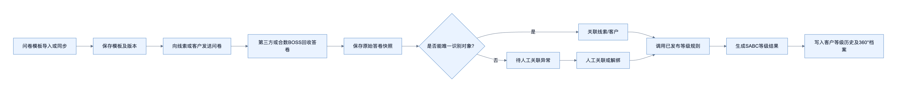
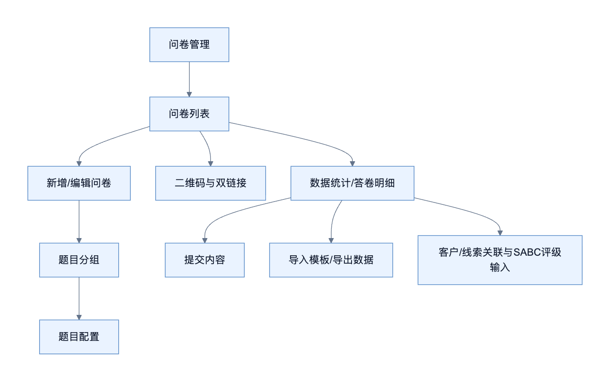
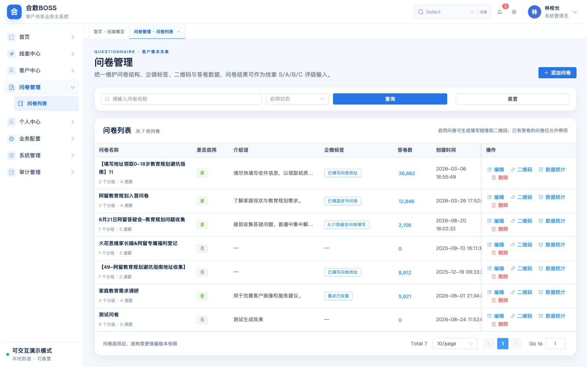
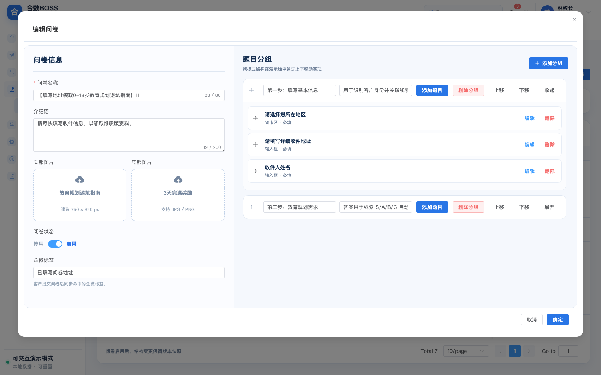
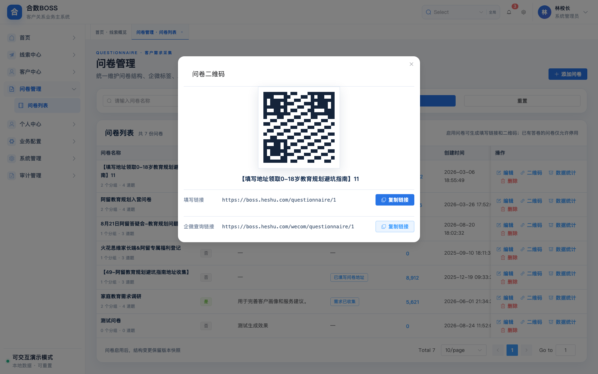
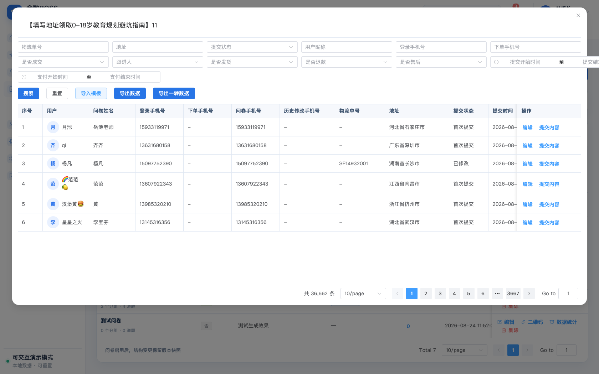
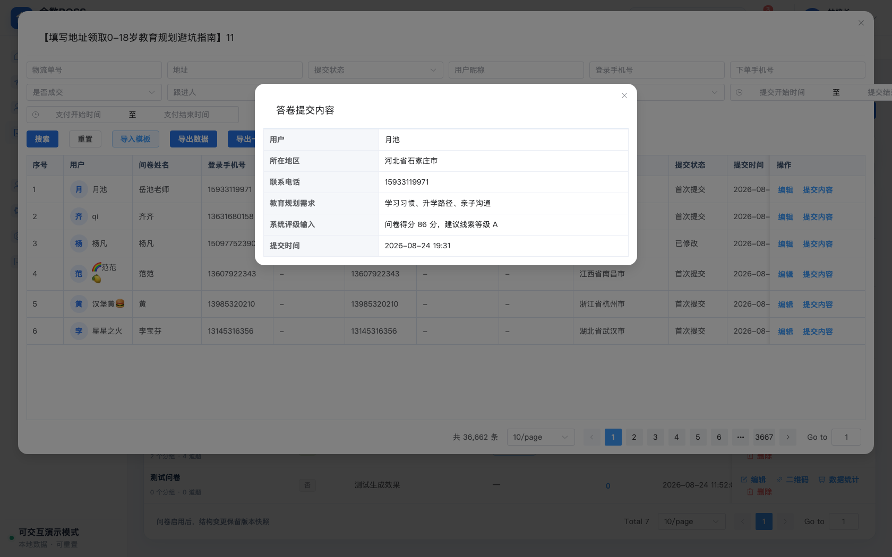
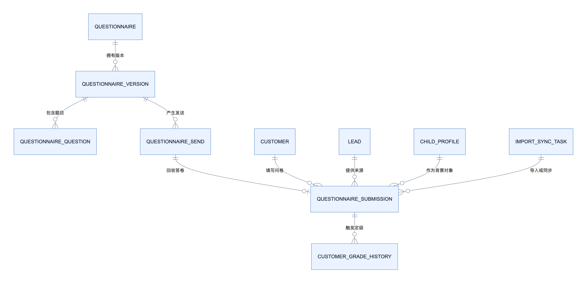

# 合数BOSS V1.0问卷管理产品需求文档（Wiki可复制细化版）

> Wiki 复制说明：正文、表格及 8 张业务图片均可直接复制；如需保留完整样式和图片，请打开同目录 HTML 后点击“复制整篇”。
>
> 文档定位：基于现行《合数BOSS V1.0问卷管理需求文档》V1.2与 2026-10-16 当前原型，细化页面字段、交互、校验、权限、异常及验收规则。
>
> 维护原则：保留问卷列表、新增/编辑、二维码与链接、数据统计与答卷、导入导出等现行模块，并以当前原型字段和最终确认规则为准；流程图及业务页面均使用可直接复制的 PNG。

## 一、文档信息

| 项目 | 内容 |
| --- | --- |
| 项目名称 | 合数BOSS重构项目—问卷管理 |
| 需求编号 | BOSS-QUESTIONNAIRE-V1.0 |
| 当前版本 | V1.3（Wiki可复制细化版） |
| 文档状态 | 产品需求评审稿 |
| 产品负责人 | 待确认 |
| 技术负责人 | 待确认 |
| 测试负责人 | 待确认 |
| 创建日期 | 2026-08-17 |
| 最近更新 | 2026-10-16 |
| 计划上线日期 | 待确认 |
| 原型地址 | `/questionnaires/list`（问卷管理—问卷列表） |
| 关联资料 | [问卷管理原需求](./合数BOSS%20V1.0问卷管理需求文档.md)、[线索中心需求](./合数BOSS%20V1.0线索中心需求文档.md) |

### 1.1 修订历史

| 版本 | 日期 | 内容 |
|---|---|---|
| V1.0 | 2026-08-17 | 从主需求文档独立形成问卷管理专项需求 |
| V1.1 | 2026-08-19 | 明确有效问卷自动评级线索、等级规则统一在线索配置维护，以及新客户首次建档继承线索当前等级 |
| V1.2 | 2026-08-26 | 按现行原型重构问卷列表、新增编辑、题目分组、五类题型、二维码双链接、答卷统计、模板导入和权限导出规格 |
| V1.3 | 2026-10-16 | 结合当前可交互原型细化页面字段、按钮行为、保存校验、删除边界、答卷筛选、运营字段补充、权限审计及验收场景，并补充业务截图 |

### 1.2 需求评审记录

| 评审日期 | 参与人 | 评审结论 | 遗留事项 | 负责人 | 截止日期 |
| --- | --- | --- | --- | --- | --- |
| 待确认 | 待确认 | 当前为产品需求评审稿 | 见 10.3 待确认事项 | 待确认 | 待确认 |

### 1.3 会议纪要

- 会议时间、参与人及纪要链接：待确认。
- 评审重点：问卷版本、身份唯一关联、SABC 定级职责边界、敏感数据权限及历史迁移。

---

## 二、原始需求登记

### 2.1 原始需求信息

| 项目 | 内容 |
| --- | --- |
| 原始需求名称 | 合数BOSS V1.0问卷管理 |
| 需求提出人 / 部门 | 待确认 |
| 提出日期 | 2026-08-17（以首版文档日期为准） |
| 期望完成时间 | 待确认 |
| 紧急程度 | 高 |
| 需求来源 | 合数BOSS重构、问卷投放与客户分级闭环 |
| 当前处理状态 | 产品需求评审中 |

### 2.2 原始需求描述

统一承接问卷模板、发送、回收、同步、答卷、客户关联和 SABC 定级输入，使每次问卷结果可追溯至发送人、填写人、模板版本、原始答案和定级规则版本。

### 2.3 原始需求拆解清单

| 编号 | 原始诉求 | 产品需求描述 | 优先级 | 本期范围 | 关联章节 |
| --- | --- | --- | --- | --- | --- |
| OR-QN-001 | 统一管理问卷 | 建立问卷列表、编辑、启停、版本及删除约束 | P0 | 是 | 5.1、5.2、5.6 |
| OR-QN-002 | 支持对外投放 | 提供二维码、填写链接和企微只读查询链接 | P0 | 是 | 5.3 |
| OR-QN-003 | 答卷可查可用 | 提供统计、明细、运营字段补充、导入与权限导出 | P0 | 是 | 5.4、5.5 |
| OR-QN-004 | 关联客户身份 | 按 UnionID、校验手机号及确认绑定关系唯一关联 | P0 | 是 | 5.7 |
| OR-QN-005 | 支撑 SABC 定级 | 输出原始答案和解析结果，触发版本化规则并保留历史 | P0 | 是 | 5.8 |

---

## 三、产品背景与目标

### 3.1 背景概述与文档目标

问卷管理统一承接问卷模板、发送、回收、同步、答卷、客户关联和SABC定级输入，使每次问卷结果能够追溯到发送人、填写人、模板版本、原始答案和定级规则版本。

V1.0只有“问卷列表”一个二级菜单。测评管理和测评列表属于V2.0，不在本模块中混建。

### 3.2 核心目标

| 目标 | 成功表现 |
| --- | --- |
| 问卷全生命周期可管理 | 模板、版本、投放、答卷和状态在统一入口管理 |
| 答卷数据可追溯 | 原始报文、题目快照、填写版本、关联与变更历史不被覆盖 |
| 身份关联安全可解释 | 唯一命中才自动关联，冲突进入人工异常流程并留审计 |
| 定级职责边界清晰 | 问卷供数、线索配置规则、客户中心消费结果，各自版本可追溯 |

### 3.3 非目标

- V1.0 不建设“测评管理”或“测评列表”，两者属于 V2.0。
- 不在问卷模块内维护 SABC 等级规则；规则由“线索配置—等级规则”负责。
- 不允许编辑答卷运营字段时覆盖原始答案，也不以问卷子女背景替代家长客户主体。

### 3.4 用户价值

| 用户角色 | 用户价值 |
| --- | --- |
| 问卷运营人员 | 统一配置、投放、统计和导入导出问卷 |
| 销售及客户负责人 | 查看可追溯答卷、关联对象和等级建议 |
| 系统管理员 | 管理权限、异常、重试和审计 |
| 客户中心使用者 | 在客户 360°档案和等级历史中消费问卷结果 |

### 3.5 核心业务流程

---

## 四、需求范围

### 4.1 信息架构与菜单

新增编辑、二维码、答卷明细、导入导出、关联异常和定级结果通过列表操作及弹窗承载，不新增左侧菜单。问卷对外投放通过填写链接或二维码完成，企微查询使用独立只读链接。

### 4.2 功能清单

| 编号 | 功能模块 | 功能说明 | 优先级 | 本期范围 | 关联章节 |
| --- | --- | --- | --- | --- | --- |
| FR-QN-001 | 问卷列表 | 查询、启停、删除约束及状态反馈 | P0 | 是 | 5.1 |
| FR-QN-002 | 新增/编辑问卷 | 基础信息、图片、标签、分组、题目和版本 | P0 | 是 | 5.2 |
| FR-QN-003 | 二维码与链接 | 二维码、填写链接和企微查询链接 | P0 | 是 | 5.3 |
| FR-QN-004 | 数据统计与答卷 | 筛选、查看快照、补充运营字段及脱敏 | P0 | 是 | 5.4 |
| FR-QN-005 | 导入与导出 | 任务化导入、幂等更新和权限导出 | P0 | 是 | 5.5 |
| FR-QN-006 | 版本、关联与定级 | 版本留痕、唯一关联、异常处理及定级输入 | P0 | 是 | 5.6—5.8 |

---

## 五、需求说明

> 本章沿用原文档的页面模块顺序，并将原 4.1—4.5 映射为 5.1—5.5。

### 5.1 问卷列表

#### 5.1.1 页面组成

页面由页面标题区、查询区、问卷列表和分页区组成。页面标题固定为“问卷管理”，说明文案明确该模块负责问卷结构、企微标签、二维码和答卷数据；右上角提供“添加问卷”。V1.0 左侧菜单仅保留“问卷列表”，不新增测评管理入口。

#### 5.1.2 查询条件

| 条件 | 控件 | 规则 |
|---|---|---|
| 问卷名称 | 文本输入框 | 支持名称关键字模糊匹配；忽略首尾空格；按 Enter 或点击“查询”执行 |
| 启用状态 | 单选下拉 | 全部、启用、停用；清空等同全部 |
| 查询 | 主按钮 | 按当前条件查询并回到第 1 页 |
| 重置 | 次按钮 | 清空名称和状态并恢复第 1 页全量列表 |

#### 5.1.3 列表字段

| 字段 | 说明 |
|---|---|
| 问卷名称 | 展示名称；第二行展示“X 个分组 · Y 道题” |
| 是否启用 | “是/否”状态标签；启用时填写链接允许提交，停用时禁止新提交 |
| 介绍语 | 问卷填写页的业务说明 |
| 企微标签 | 答卷有效提交后需同步的企业微信标签，可多值 |
| 答卷数 | 已提交答卷数量；蓝色数字可点击进入该问卷数据统计 |
| 创建时间 | 问卷首次创建时间 |
| 操作 | 编辑、删除、二维码、数据统计 |

#### 5.1.4 行操作与删除边界

| 操作 | 前置条件 | 处理结果 |
|---|---|---|
| 编辑 | 具备编辑权限 | 打开编辑弹窗；已有答卷时结构变更形成新版本，不覆盖历史快照 |
| 二维码 | 具备链接查看权限 | 打开二维码与双链接弹窗；停用问卷仍可查看历史查询链接 |
| 数据统计 | 具备答卷查看权限 | 打开当前问卷答卷数据弹窗，并继承当前问卷上下文 |
| 删除（无答卷） | 答卷数为 0 且具备删除权限 | 二次确认后物理删除草稿问卷 |
| 删除（有答卷） | 答卷数大于 0 | 禁止物理删除；提示“已有 N 份答卷，是否改为停用”，确认后仅停用 |

列表默认按创建时间倒序；默认每页 10 条，支持 10/20/50 条切换、页码与跳页。加载中显示骨架或加载态；请求失败保留查询条件并允许重试；无数据与无搜索结果分别展示不同空状态。

### 5.2 新增/编辑问卷

编辑弹窗采用左右双栏：左侧维护问卷基础信息，右侧维护题目分组和题目。新增时默认创建 1 个空分组且状态为停用；编辑时带出当前有效版本内容。

#### 5.2.1 问卷基础信息

| 区域 | 字段/能力 | 规则 |
|---|---|---|
| 问卷信息 | 问卷名称 | 必填，1—80 字；保存时校验同一租户内有效问卷名称不重复 |
| 问卷信息 | 介绍语 | 选填，最多 200 字，展示于填写页头部 |
| 问卷信息 | 头部图片 | 选填，建议 750×320 px；支持 JPG/PNG、预览、替换和删除 |
| 问卷信息 | 底部图片 | 选填；支持 JPG/PNG、预览、替换和删除 |
| 问卷信息 | 问卷状态 | 停用/启用；至少存在1道有效题目后方可启用 |
| 问卷信息 | 企微标签 | 选填、多值；有效提交后同步标签，失败进入企微异常与重试，不回滚答卷 |

#### 5.2.2 分组与题目管理

| 对象 | 能力 | 规则 |
|---|---|---|
| 题目分组 | 分组标题/描述 | 标题必填；支持新增、删除、折叠、展开和拖动排序 |
| 题目分组 | 删除 | 二次确认；删除分组时同时移除该草稿版本下的题目，不影响历史版本 |
| 题目分组 | 排序 | 当前原型通过“上移/下移”实现；正式产品可使用拖拽，排序结果必须稳定保存 |
| 题目 | 题目名称 | 必填；同一分组内排序稳定 |
| 题目 | 题目类型 | 输入框、文本域、单选组、多选组、省市区 |
| 题目 | 是否必填/输入提示 | 必填校验在提交时执行，错误定位到具体题目 |
| 题目 | 选项 | 单选组、多选组必须至少配置2个不重复选项 |

#### 5.2.3 保存校验

1. 问卷名称为空：阻止保存并提示“请输入问卷名称”；
2. 无题目分组：阻止保存并提示“请至少创建一个题目分组”；
3. 状态为启用但没有任何有效题目：阻止保存并提示“启用问卷前请至少配置一道题目”；
4. 分组标题、题目名称或选项不合规：定位到具体分组或题目；
5. 取消或关闭：不保存本次草稿修改；存在未保存修改时应二次确认；
6. 保存成功：新增返回列表首行；编辑刷新当前行并提示“历史答卷仍保留提交时版本”。

编辑已产生答卷的问卷时不得覆盖历史题目结构；结构变化生成草稿新版本，发布后仅供新答卷使用，历史答卷继续关联提交时版本与题目快照。

### 5.3 二维码与链接

点击“二维码”展示问卷二维码、问卷名称、填写链接和企微查询链接，并提供分别复制：

| 内容 | 使用对象 | 规则 |
|---|---|---|
| 二维码 | 外部客户 | 内容指向当前已发布版本的填写链接；不得指向草稿 |
| 填写链接 | 外部客户 | 启用时可填写并提交；停用时展示停用页，不允许新提交 |
| 企微查询链接 | 内部企微员工 | 只读查询历史答卷；需鉴权并按数据范围展示 |

复制成功提示“链接已复制”；浏览器拒绝剪贴板权限时显示可手工复制的完整链接。重新发布新版本后，新生成链接指向新版本；历史答卷查询仍按提交版本展示。

### 5.4 数据统计与答卷记录

点击答卷数或“数据统计”打开当前问卷答卷页。弹窗标题使用问卷名称，并固定当前问卷上下文，不能跨问卷混查。

#### 5.4.1 查询条件

| 条件 | 匹配方式 | 备注 |
|---|---|---|
| 物流单号、用户昵称、登录手机号、下单手机号 | 包含匹配 | 手机号查询需具备敏感字段查询权限 |
| 地址 | 包含匹配 | 支持省、市、区及详细地址关键字 |
| 提交状态 | 精确匹配 | 首次提交、已修改 |
| 是否成交、是否发货、是否退款、是否售后 | 精确匹配 | 取订单或售后事实状态，不从备注推断 |
| 跟进人 | 精确匹配 | 受当前数据范围约束 |
| 提交时间、支付时间 | 起止时间闭区间 | 开始时间不得晚于结束时间 |

答卷列表至少展示用户、问卷姓名、登录手机号、下单手机号、问卷手机号、历史修改手机号、物流单号、地址、提交状态、提交时间和操作。操作包含“编辑”和“提交内容”：

- “提交内容”只读展示提交时题目与答案快照、关联对象、问卷得分、建议线索等级和提交时间；
- “编辑”仅允许具备权限的人员补充问卷手机号、物流单号、收件地址和提交状态，不得覆盖原始题目答案；
- 手机号等敏感字段按字段权限脱敏，查看明文与导出均记录审计；
- 筛选无结果时保留筛选条件并展示空状态，不能误显示全量数据。

#### 5.4.2 答卷修改规则

答卷原始答案与运营补充字段分开保存。每次保存运营字段需记录修改前值、修改后值、操作人、操作时间和原因；提交状态从“首次提交”变为“已修改”后不得自动回退。修改手机号触发身份重校验，若命中其他客户或产生冲突，不立即改绑，进入业务异常等待人工处理。

### 5.5 导入与导出

| 操作 | 数据范围 | 规则 |
|---|---|---|
| 导入模板 | 当前问卷 | 仅接收标准模板；校验问卷编号、答卷唯一键、字段类型和必填列 |
| 导出数据 | 当前问卷 + 当前筛选 | 导出筛选后的全部答卷，不只导出当前页 |
| 导出一转数据 | 当前问卷 + 当前筛选 | 仅导出符合一转口径的数据；具体口径由数据字典统一维护 |

导入以后台任务执行并展示总数、成功、重复、失败及失败原因；重复数据按答卷唯一键更新允许补充的运营字段，不重复创建答卷。导出严格应用用户数据范围、字段权限和脱敏规则，生成记录写入“个人中心—下载记录”，大数据量采用异步文件。

### 5.6 模板与版本规则

- 问卷编号稳定，列表中的问卷名称可调整，模板每次结构变化生成新版本；
- 已发布版本不可直接修改，编辑产生草稿新版本；
- 答卷永久关联填写时的模板版本和题目快照；
- 题目删除、选项调整和分值改变不得影响历史答卷；
- 停用问卷后填写链接不能新提交，但二维码、历史答卷、企微查询链接和定级仍可查询；
- 外部问卷保留来源系统、外部问卷ID和外部版本；
- 标准模板导入必须校验题目编码和选项编码稳定性。

### 5.7 身份关联规则

1. 优先使用UnionID匹配客户；
2. 其次使用已校验手机号；
3. 可使用已确认的外部客户编号或发送任务与线索/客户的绑定关系；
4. 同一标识命中多个客户时不得自动选择；
5. 两种身份分别命中不同客户时进入撞单或问卷关联异常；
6. 无法唯一匹配时保存答卷但标记待处理，不丢弃数据；
7. 人工关联、解绑或改绑必须填写原因、具备权限并保存审计；
8. 孩子仅作为答卷背景关联，问卷填写人和客户主体仍为家长。

### 5.8 SABC 定级

问卷管理负责提供原始答案和解析结果；“线索配置—等级规则”当前仅维护“家庭教育需求问卷规则”，负责查看详情、编辑生成新版本、冲突检测、版本记录、启停与版本回退，不提供试算入口；客户列表负责查看当前等级及等级历史。线索和客户共用 `lead_customer_grade` 字典的 S/A/B/C 值；有效答卷优先对关联线索自动评级，新客户首次建档继承线索当前等级，建档后客户等级独立维护；完整规则见《[合数BOSS V1.0——线索中心需求文档](./合数BOSS V1.0线索中心需求文档.md)》等级规则章节。

定级结果必须保存问卷版本、答卷编号、等级规则版本、总分、各维度得分、必要条件、命中规则、计算时间和是否当前有效。

重新同步、重新解析或规则重算必须产生新的等级记录，不覆盖旧结果。未命中有效规则时客户显示“未定级”，并记录未命中原因。

---

## 六、通用业务规则

### 6.1 状态模型

| 对象 | 状态 |
|---|---|
| 问卷模板 | 草稿、已发布、已停用 |
| 发送记录 | 待发送、发送中、已发送、发送失败、已失效 |
| 答卷 | 待解析、已解析、解析失败、待关联、已关联、已作废 |
| 同步任务 | 待执行、执行中、成功、部分成功、失败、已取消 |
| 定级 | 未计算、计算成功、未命中、计算失败、已失效 |

问卷状态、发送状态、答卷状态、关联状态和定级状态分别保存。

### 6.2 核心数据模型

原始答卷与解析结果分开保存；原始报文只追加不覆盖；外部答卷以来源系统和外部答卷ID幂等；发送任务、答卷、客户关联和等级结果均保留历史。

### 6.3 接口与事件

主要接口：问卷同步、模板导入、问卷查询、发送、答卷回调/导入、答卷关联、重新解析和定级触发。

主要事件：`questionnaire.published`、`questionnaire.sent`、`questionnaire.submitted`、`questionnaire.link_failed`、`questionnaire.linked`、`customer.grade_calculated`。回调和同步按外部事件ID或答卷ID幂等。

### 6.4 权限、安全与审计

- 菜单权限控制问卷列表；
- 新增、编辑、删除、启停、二维码、模板导入、查看完整答案、人工关联、解绑和导出分别配置按钮/字段权限；
- 问卷答案、手机号、UnionID和诊断相关敏感信息按字段权限脱敏；
- 数据范围按问卷适用组织、发送人、客户负责人和授权角色计算；
- 人工关联、解绑、导出和模板发布记录审计。

---

## 七、异常与边界处理

以下情况进入页面异常队列并同步异常中心：模板结构不兼容、题目编码缺失、答卷解析失败、UnionID/手机号冲突、命中多个客户、发送失败、重复答卷内容冲突和定级规则执行失败。

异常支持查看原始数据、重新解析、重新关联、忽略、关闭和重试。忽略必须填写原因，不得删除原答卷。

| 边界场景 | 系统处理 | 数据原则 |
| --- | --- | --- |
| 问卷停用 | 填写链接禁止新提交，历史答卷和企微查询仍可用 | 不删除历史数据 |
| 已有答卷后改结构 | 生成草稿新版本，发布后供新答卷使用 | 历史答卷仍指向原版本和快照 |
| 标识命中多个客户或彼此冲突 | 不自动选择，进入关联异常 | 原答卷保留，人工处理留原因和审计 |
| 重复回调或导入 | 按来源系统、外部事件 ID 或答卷 ID 幂等 | 不重复创建答卷 |
| 定级失败或未命中 | 记录原因，允许重算并产生新记录 | 不覆盖旧等级记录 |

---

## 八、数据埋点与监控

### 8.1 关键事件

| 事件 | 触发时机 | 关键属性 | 指标用途 |
| --- | --- | --- | --- |
| questionnaire.published | 问卷版本发布成功 | 问卷、版本、操作人 | 发布成功率 |
| questionnaire.sent | 发送任务完成 | 问卷、版本、发送对象、结果 | 发送成功率 |
| questionnaire.submitted | 答卷有效提交 | 问卷、版本、来源、答卷 ID | 提交量与完成率 |
| questionnaire.link_failed / linked | 自动关联失败或关联完成 | 标识类型、冲突原因、关联方式 | 自动关联率、异常积压 |
| customer.grade_calculated | 定级计算结束 | 答卷、规则版本、等级、结果 | 定级成功率与未命中率 |

### 8.2 监控指标

| 监控项 | 统计口径 | 目标 / 告警阈值 | 频率 | 负责人 |
| --- | --- | --- | --- | --- |
| 答卷回收成功率 | 成功保存答卷数 / 有效回调数 | 待确认 | 实时 | 待确认 |
| 解析失败率 | 解析失败答卷数 / 已回收答卷数 | 待确认 | 实时 | 待确认 |
| 关联异常积压 | 待人工关联且未关闭数量 | 待确认 | 每日 | 待确认 |
| 定级计算失败率 | 计算失败数 / 定级触发数 | 待确认 | 实时 | 待确认 |
| 导入导出任务失败率 | 失败任务数 / 已完成任务数 | 待确认 | 每批次 | 待确认 |

---

## 九、验收标准

- [ ] 问卷列表支持名称/状态筛选、查询、重置、分页和明确状态反馈；
- [ ] 新增/编辑支持问卷基础信息、图片、企微标签、题目分组和五类题型；
- [ ] 启用前校验至少存在1道有效题目；
- [ ] 二维码、填写链接和企微查询链接可生成、复制并对应正确问卷版本；
- [ ] 数据统计支持业务筛选、答卷查看、授权补充、模板导入和按权限导出；
- [ ] 已产生答卷的问卷模板不能覆盖或物理删除；
- [ ] 原始答卷、模板版本和题目快照完整保留；
- [ ] 答卷可按UnionID或手机号唯一关联线索/客户；
- [ ] 多客户冲突时进入异常，不自动选择；
- [ ] 人工关联或解绑可审计；
- [ ] 问卷结果可触发可解释的SABC定级并保留等级历史；
- [ ] 重新定级不覆盖旧结果；
- [ ] 导入、同步和回调重复提交不产生重复答卷；
- [ ] 测评管理不会出现在V1.0菜单中。

---

## 十、项目排期与依赖

### 10.1 关键里程碑

| 里程碑 | 计划时间 | 交付物 | 负责人 | 状态 |
| --- | --- | --- | --- | --- |
| 需求评审与基线确认 | 待确认 | PRD、原型、接口和数据模型评审结论 | 待确认 | 待开始 |
| 问卷与答卷主流程联调 | 待确认 | 模板、版本、投放、回收和查询联调记录 | 待确认 | 待开始 |
| 关联与定级联调 | 待确认 | 身份关联、异常处理、规则触发和历史记录验收 | 待确认 | 待开始 |
| 灰度上线 | 待确认 | 上线清单、监控和回滚演练 | 待确认 | 待开始 |

### 10.2 外部依赖

| 依赖项 | 依赖方 | 所需内容 | 最晚完成时间 | 备用方案 |
| --- | --- | --- | --- | --- |
| 问卷来源系统 | 外部问卷系统 / 业务方 | 模板、答卷接口、外部 ID 和版本定义 | 待确认 | 使用标准模板人工导入 |
| 企业微信 | 企业微信及系统管理 | UnionID、标签同步及只读查询入口 | 待确认 | 失败进入重试，不阻断答卷保存 |
| 线索配置 | 线索中心 | 已发布的“家庭教育需求问卷规则”、版本、冲突检测及回退能力 | 待确认 | 标记未定级并保留原因 |
| 客户中心 | 客户中心 | 客户唯一标识、360°档案及等级历史写入能力 | 待确认 | 答卷先保留为待关联 |

### 10.3 待确认事项

- V1.0使用的问卷来源系统和接口负责人；
- 标准模板与历史问卷字段映射；
- 问卷重复发送时间窗；
- SABC等级规则的业务负责人和发布审批人；
- 哪些问卷必须关联孩子背景；
- 历史答卷可迁移范围和身份覆盖率。

---

## 十一、上线方案

### 11.1 发布与回滚策略

- 问卷模板和等级规则均采用版本发布；
- 新模板先灰度发送，异常时停用新版本并恢复上一版本；
- 错误客户关联通过解绑及重新关联恢复；
- 错误定级通过失效错误结果并生成新结果恢复；
- 同步适配器异常时关闭自动同步，切换人工导入；
- 回滚不得删除发送记录、答卷、原始报文、关联历史和等级历史。

### 11.2 上线检查清单

- [ ] V1.0 菜单仅包含“问卷列表”，未混入 V2.0 测评功能。
- [ ] 模板版本、题目快照、原始答卷和历史关联均已完成数据校验。
- [ ] UnionID、手机号及外部绑定关系的唯一关联和冲突流程已验证。
- [ ] 敏感字段脱敏、服务端鉴权、导出权限和审计已验证。
- [ ] 回调、导入、同步、重试及定级触发幂等已验证。
- [ ] 监控、灰度范围、应急联系人和回滚演练已确认。

---

## 十二、附录

- 原始需求：[问卷管理需求文档](./合数BOSS%20V1.0问卷管理需求文档.md)
- 关联需求：[线索中心需求文档](./合数BOSS%20V1.0线索中心需求文档.md)
- 原型路由：`/questionnaires/list`
- 流程图与业务截图：`./assets/questionnaire-wiki`

### 12.1 图片清单

| 编号 | 图片 | 对应章节 |
|---|---|---|
| 01 | 问卷列表 | 5.1 |
| 02 | 编辑问卷与题目分组 | 5.2 |
| 03 | 问卷二维码与双链接 | 5.3 |
| 04 | 答卷数据统计 | 5.4 |
| 05 | 答卷提交内容 | 5.4 |
| 06 | 问卷管理信息架构 | 3.5 |
| 07 | 问卷业务流程 | 4.1 |
| 08 | 问卷核心数据模型 | 6.2 |
