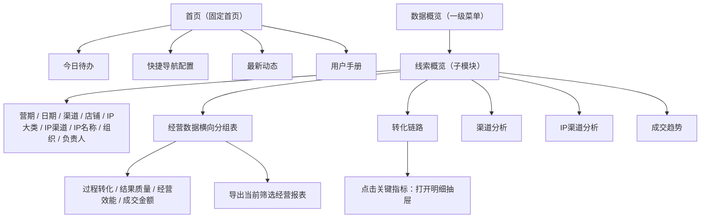

# 合数BOSS V1.0——首页与数据概览详细需求

| 文档属性 | 内容 |
|---|---|
| 所属项目 | 合数BOSS重构项目 |
| 所属版本 | V1.0 |
| 一级菜单 | 首页、数据概览 |
| 文档版本 | V1.17 |
| 文档状态 | 产品需求评审稿 |
| 更新日期 | 2026-10-19 |

## 1. 文档目标

“首页”是合数BOSS人员进入系统后的固定入口，直接打开原工作台页面，用于汇总当前用户的待办、常用入口、最新业务动态和使用帮助；首页不再设置“工作台”二级菜单。“数据概览”作为首页下方新增的独立一级模块，当前包含“线索概览”子模块，承担线索全链路经营分析。首页与数据概览职责分离。

V1.16 口径：首页使用 `/home/workbench`，登录成功、根路径、未知地址和历史 `/dashboard` 均进入首页；首页是不可关闭的固定首个页签。侧边栏在首页下方新增“数据概览”，点击后展开“线索概览”；线索概览继续使用 `/leads/analytics`，作为“数据概览”下可关闭的普通业务页签。

V1.17 口径：线索概览中的统计卡片按角色配置权限展示；用户无对应卡片权限时整张卡片不展示，不以0值或置灰卡片代替。经营数据当前置灰部分及原型截图红框部分因数据库数据尚未导入而无数据，数据库导入后可能产生数据，首期不纳入测试。

V1.15 口径：新增独立工作台 `/home/workbench`，登录成功、根路径、未知地址和历史 `/dashboard` 均进入工作台；工作台是不可关闭的固定首页页签。工作台展示动态问候、今日待办、最多 6 个可记忆的快捷导航、最新动态和用户手册。线索概览保留 `/leads/analytics`，作为首页下的经营分析页面，不再承担默认登录入口。

V1.9 口径：线索概览不再展示预约直播、到课、完课及商品分析；期次、渠道、店铺、IP渠道、IP名称支持多选。时间筛选拆分为“期次时间”和“线索创建时间”，页面默认选择距当前日期最近的启用期次，并带出该期次起止日期。成交趋势同时展示“成交订单数（个）”和“成交金额（万元）”。

V1.11 口径：页面链路名称统一为“转化链路”，经营模块统一命名为“经营数据”，不再切换“期次经营数据/线索经营数据”名称。单选期次展示一行期次数据；多选期次时先展示汇总行，再逐行展示各期次数据；不选择期次、仅按线索创建时间筛选时展示正常汇总，期次列留空。

V1.12 口径：经营数据的过程转化新增 DAY1、DAY2、DAY3 到课率及完课率。列表右上角提供表头字段设置，期次为固定列，其他指标可自由选择、自动记忆并支持恢复默认。

V1.13 口径：经营数据的过程转化默认新增“有效线索数”，按当前筛选条件统计去重后的有效线索，并支持下钻查看对应线索明细。已有用户保存过表头设置时，系统自动补入该指标，避免版本升级后遗漏。

V1.14 口径：业务筛选区在IP渠道、IP名称之前增加“IP大类”多选筛选。选项统一读取启用的 `ip_category` 字典项，查询后对经营数据、转化链路、渠道/IP渠道分析、成交趋势、指标下钻和导出整页生效。

线索概览不生成独立业务数据，只聚合各模块统计结果并下钻原始业务页面；所有数据必须遵循当前员工的数据岗位范围、业务角色功能权限和字段权限。

## 2. 页面信息架构

| 页面区域 | V1.0内容 |
|---|---|
| 首页 | 固定展示原工作台页面；展示当前用户问候与今日待办，允许从候选模块中选择 1—6 个快捷入口并按用户记忆；最新动态可进入对应业务页面；用户手册在帮助中心未开放前明确提示原型状态 |
| 数据概览—线索概览 | 按期次、期次时间或线索创建时间展示经营数据；集中展示转化链路、过程转化、结果质量、经营效能、成交金额、渠道、IP渠道和成交趋势，支持多期汇总、指标下钻、表头设置及分区导出 |

## 3. 页面与交互详细说明

### 3.1 页面入口与默认行为

- 点击一级菜单“首页”直接打开 `/home/workbench`，不展开二级菜单；
- 原工作台页面对外统一命名为“首页”，是登录成功后的默认页面和不可关闭的固定首个页签；
- 根路径、未知地址和历史 `/dashboard` 地址自动跳转到 `/home/workbench`；
- “数据概览”位于“首页”下方，点击后展开其子模块“线索概览”；
- “线索概览”使用 `/leads/analytics`，页签标题为“数据概览 · 线索概览”，作为普通业务页签打开并允许关闭；
- 原线索分析统一更名为“线索概览”，保留渠道分析和IP渠道分析，移除商品分析；
- 首次进入默认选择距当前日期最近的启用期次并带出其起止时间；期次支持多选，也可清空期次及期次时间后仅按线索创建时间汇总；
- 页面刷新、打开其他系统页签后返回、关闭浏览器后再次登录，均恢复该用户最近一次成功查询条件；已失效或已无权限的筛选值自动清除并提示；
- 主管可按授权组织切换，普通员工只能查看本人或已特别授权的数据；任何筛选、下钻和导出均不得突破当前权限范围。

### 3.1.1 首页（原工作台）交互

- 欢迎区展示当前登录用户姓名、按本地时间计算的问候语、日期和今日待办汇总；无用户显示名时使用系统兜底名称；
- 今日待办汇总展示待分配线索、新答卷和待处理异常的数量摘要；正式开发必须由有权限的业务接口返回，不得把原型演示数字写入生产逻辑；
- 快捷导航默认展示引流线索、活码管理、客户列表和问卷管理，候选范围另含引流期次和业务异常；只展示当前用户有菜单权限的候选项；
- 点击配置快捷导航打开弹窗，至少保留 1 个、最多选择 6 个；保存后按“用户ID + 工作台”记忆，取消不修改原配置；已失效或失权入口在加载时自动剔除；
- 最新动态按时间倒序展示时间、标题、摘要和业务类型，点击进入对应业务页面；目标页面无权限时不展示该条可点击入口；
- 用户手册包含新手入门、线索运营手册和系统配置指南；帮助中心未开放时明确提示“当前为原型演示”，不得跳转空白页面；
- 工作台无权读取业务明细时只展示用户有权模块的汇总，不以跨权限总数代替；接口部分失败时各区块独立降级，不影响快捷导航使用。

### 3.2 页面区域与展示顺序

| 顺序 | 页面区域 | 详细说明 |
|---|---|---|
| 1 | 页面标题区 | 展示“线索概览”、页面说明、指标口径和刷新数据 |
| 2 | 权限与业务筛选区 | 展示权限范围、数据视图、归属组织、负责人、营期、日期、来源渠道、店铺、IP大类、IP渠道和IP名称 |
| 3 | 经营数据 | 单期展示一行，多期展示汇总行及各期次行；不选期次、仅按线索创建时间筛选时正常汇总且期次列留空；右上角提供表头设置和导出入口 |
| 4 | 转化链路 | 按有效线索、加微、填写问卷、成交展示阶段人数和环节转化率，并补充当前在线、退款等结果信号 |
| 5 | 指标下钻 | 经营数据和保留分析区中的可下钻指标打开明细抽屉，并继承当前全部筛选及权限快照 |
| 6 | 渠道分析 | 展示来源渠道效果对比，支持指标下钻与独立导出 |
| 7 | IP渠道分析 | 展示IP渠道效果对比，支持指标下钻与独立导出 |
| 8 | 成交趋势 | 同时展示成交订单数（个）和成交金额（万元） |
| 9 | 指标明细抽屉 | 点击关键人数打开，不离开当前页面；展示订单、客户、来源、店铺、商品、IP归因、负责人、负责人组织和事件时间 |

### 3.2.1 统计卡片角色权限

- 线索概览中的统计卡片必须配置稳定的卡片权限编码，并纳入角色权限配置；角色可分别控制各统计卡片是否可见；
- 用户拥有多个角色时，统计卡片权限取各有效角色权限并集；角色停用或权限收回后，下次进入或刷新页面立即按最新权限生效；
- 无卡片查看权限时，前端不得请求或渲染对应卡片数据，页面不保留空白占位，不以0值、脱敏值或置灰卡片代替；
- 卡片可见权限不等于敏感字段权限。金额、手机号等内容仍需叠加字段权限判断；无字段权限时按既有规则隐藏或脱敏；
- 卡片权限仅控制展示范围，不改变指标口径、数据岗位范围、组织范围、下钻权限或导出权限。

### 3.2.2 首期数据与测试边界

> **首期说明：经营数据置灰部分、红框部分无数据，数据库导入后或有数据，首期不纳入测试。**

- “置灰部分、红框部分”以当前线索概览业务截图标注区域为准；当前无数据的原因是对应数据库数据尚未完成导入，不代表指标永久为0；
- 首期测试不校验上述区域的数据值、比率、下钻明细及导出结果，不将其作为上线验收阻断项；
- 数据库导入完成后，产品、研发和测试需重新确认数据口径、权限范围及测试样本，再纳入后续测试；
- 在数据未导入前不得使用模拟值或固定0值冒充真实业务数据。

### 3.3 筛选项说明

| 筛选项 | 控件与数据来源 | 默认值 | 联动与校验规则 |
|---|---|---|---|
| 权限范围提示 | 只读提示 | 当前岗位可见范围 | 仅提示权限上限，不允许用户自行扩大 |
| 数据视图 | 下拉：全部授权数据、我的数据 | 全部授权数据；普通员工固定为我的数据 | 选择“我的数据”后负责人固定为本人；无公司级权限时不展示超范围选项 |
| 归属组织 | 可搜索公司—部门—小组树 | 当前岗位默认组织范围 | 选择上级包含其全部下级；负责人候选人随组织缩小 |
| 当前线索负责人 | 支持姓名、员工编号搜索 | 全部可见负责人 | 仅展示所选组织和权限范围内员工；离职员工历史数据仍可查询 |
| 期次 | 可搜索多选下拉，V1.0 来源为外部/历史系统同步的只读期次库 | 距当前日期最近的启用期次 | 单期展示一行；多期展示汇总及各期次行；可清空 |
| 期次时间 | 日期范围 | 默认期次起止时间 | 与期次共同限定期次数据；可清空 |
| 线索创建时间 | 日期范围 | 默认期次起止时间 | 未选择期次及期次时间时，按该时间圈定线索并汇总其后续转化结果 |
| 来源渠道 | 可搜索下拉，来源为渠道管理 | 全部渠道 | 选择后联动店铺、商品和渠道分析，未匹配选项自动清空 |
| 店铺 | 可搜索下拉，来源为店铺管理 | 全部店铺 | 受来源渠道约束；按第三方店铺ID统计，不按名称模糊归并 |
| IP大类 | 可搜索多选下拉，来源为启用的 `ip_category` 字典项 | 全部IP大类 | 选择后仅统计所选大类归因数据，并联动缩小IP渠道和IP名称候选范围 |
| IP渠道 | 可搜索下拉，来源为IP配置 | 全部IP渠道 | 选择后IP名称仅显示该渠道下的IP |
| IP名称 | 可搜索下拉，来源为IP列表 | 全部IP | 以IP编号作为查询身份，名称仅用于展示 |
| 查询 | 主按钮 | — | 统一提交全部筛选；查询成功后更新URL查询快照和用户偏好 |
| 刷新数据 | 页面按钮 | — | 保留筛选条件重新请求数据，不重置筛选 |

筛选条件对转化主链路、指标、金额、渠道、IP渠道、趋势、下钻和导出统一生效。跨模块跳转时携带筛选快照：`period`、`dateStart`、`dateEnd`、`sourceChannel`、`storeId`、`ipCategory`、`ipChannelCode`、`ipId`、`organizationId`、`ownerId`、`viewScope`和`metricVersion`。手机号、UnionID等敏感身份不得写入URL。

### 3.4 点击、下钻与跳转总规则

- **本页抽屉**：点击指标数字先在当前页打开明细抽屉，不新增顶部页签；抽屉继承点击时的筛选、指标、维度、数据权限和字段权限快照；
- **跨模块跳转**：从明细抽屉点击业务对象时，以新的系统页签打开目标模块，线索概览页签继续保留；
- **重复页签**：目标页签已经打开时激活原页签并更新查询条件，不重复创建同一路由页签；
- **返回行为**：关闭目标页签或切回线索概览后，原筛选条件、滚动位置和已加载数据保留；
- **权限不足**：无目标模块菜单权限时字段仅以普通文本展示，不出现链接；无指标下钻权限时数字不可点击；
- **无数据**：数量为0时仍显示0，但点击后展示空明细；分母为0的比率显示“—”且不可下钻；
- **字段脱敏**：手机号等敏感信息根据字段权限展示掩码或明文；导出使用同一权限判定。

### 3.5 页面全部操作点说明

#### 3.5.1 标题、筛选与报表操作

| 操作点 | 点击结果 | 目标/携带信息 | 备注 |
|---|---|---|---|
| 数据概览—线索概览菜单 | 打开或激活线索概览业务页签 | `/leads/analytics` | 可按普通业务页签关闭，首页固定保留 |
| 指标口径 | 打开右侧“数据指标口径”抽屉 | 当前口径版本、指标定义、计算公式、数据源、退款归属规则 | 不改变筛选 |
| 导出经营报表 | 导出当前筛选经营报表 | 期次、双时间、全部业务筛选、权限快照、口径版本 | 包含经营概览、渠道和IP渠道数据，不包含已移除的商品分析 |
| 刷新数据 | 重新加载全页聚合数据 | 保留全部筛选 | 更新“更新时间”，失败时保留最近成功数据 |
| 查询 | 应用全部筛选 | 当前页面 | 查询过程中按钮进入加载态，禁止重复提交 |

#### 3.5.2 转化链路、经营数据与下钻

| 操作点 | 点击结果 | 明细默认条件 | 后续可进入 |
|---|---|---|---|
| 有效线索 | 打开线索明细抽屉 | 有效且已解密的去重线索 | 引流线索 `/leads/drainage` |
| 加微 | 打开加微线索明细抽屉 | 已产生有效企微加好友事件 | 引流线索、客户列表 |
| 填写问卷 | 打开问卷线索明细抽屉 | 已提交有效问卷 | 引流线索、客户列表、问卷列表 `/questionnaires/list` |
| 成交 | 打开成交线索明细抽屉 | 正式课支付成功且可关联线索 | 引流线索、客户列表 |
| 当前在线 | 打开当前在线明细抽屉 | 查询时点在线状态为在线 | 引流线索、客户列表 |
| 退款 | 打开退款客户明细抽屉 | 退款成功且归属当前统计期 | 引流线索、客户列表 |
| 加微率、问卷填写率、预约率、到课率、完课率、转化率、退款率、最终转化率 | 打开对应分子明细抽屉 | 沿用当前分母口径，抽屉展示分子、分母与比率 | 对应线索/客户列表 |
| 人服比 | V1.0不跳转 | 仅展示该营期汇总值 | 后续版本可增加团队下钻 |
| 毛GMV、净GMV | V1.0不跳转 | 仅展示当前权限范围内金额 | 无金额权限时隐藏或脱敏 |

经营数据表的分组如下，期次列固定，其他字段可由用户设置：

| 一级分组 | 二级指标 | 展示规则 |
|---|---|---|
| 过程转化 | 有效线索数、加微率、问卷填写率、DAY1/2/3到课率、DAY1/2/3完课率 | 有效线索数展示去重数量；其余主值展示比率，副值展示对应人数；可下钻指标继承当前筛选 |
| 结果质量 | 退款率、最终转化率、GMV完成率 | 退款率和最终转化率展示比率及人数；GMV完成率展示比率、目标金额与进度条 |
| 经营效能 | 人服比、单人净GMV、团队转化离散率、当前在线 | 汇总展示；当前在线支持打开人员/线索明细，其余指标按权限展示 |
| 成交金额 | 毛GMV、退款金额、净GMV | 使用统一金额口径；退款金额使用警示色，净GMV使用重点色 |

- 横向空间不足时，仅经营数据表自身横向滚动，左侧期次列保持固定；
- 表头设置即时生效、自动记忆并支持恢复默认；期次列不可取消；
- 本次改版只替换原“本期关键指标”和“成交质量”的顶部展示样式，不修改已有指标计算口径、明细下钻条件及下方分析模块；
- 明细抽屉和明细导出必须同时包含`负责人`、`负责人组织`。负责人组织取业务事实发生时的归属组织快照，禁止因后续调岗重写历史经营归属。

#### 3.5.3 渠道与IP渠道分析

| 操作点 | 点击结果 | 目标/参数 |
|---|---|---|
| 渠道名称 | 新页签打开渠道管理并定位该渠道 | `/leads/channels?channelCode={code}` |
| 渠道线索数、加微数、问卷数、成交数 | 打开当前渠道对应指标明细抽屉 | 继承全局筛选并增加`channelCode`和指标阶段 |
| 导出渠道分析 | 下载当前渠道分析分区 | 当前全部筛选、渠道维度、权限和口径版本 |
| IP渠道名称/编号 | 新页签打开IP列表并筛选该IP渠道 | `/leads/ip?ipChannelCode={code}` |
| IP渠道线索数、加微数、成交数 | 打开当前IP渠道对应指标明细抽屉 | 继承全局筛选并增加`ipChannelCode`和指标阶段 |
| 导出IP渠道分析 | 下载当前IP渠道分析分区 | 当前全部筛选、权限和口径版本 |

#### 3.5.4 明细抽屉内跳转

| 明细字段/操作 | 点击结果 | 目标路由与筛选 |
|---|---|---|
| 订单编号 | 打开引流线索并定位订单 | `/leads/drainage?orderNo={orderNo}` |
| 客户名称/客户编号 | 打开客户列表并定位客户 | `/customers/list?customerNo={customerNo}` |
| 来源渠道 | 打开渠道管理 | `/leads/channels?channelCode={channelCode}` |
| 店铺 | 打开店铺管理 | `/leads/stores?storeId={storeId}` |
| 商品 | 打开商品列表 | `/leads/products?productId={productId}` |
| IP渠道/IP名称 | 打开IP列表 | `/leads/ip?ipChannelCode={code}`或`/leads/ip?ipId={ipId}` |
| 负责人 | 打开员工管理并定位员工 | `/system/employees?employeeNo={employeeNo}` |
| 负责人组织 | 打开组织管理并定位组织 | `/system/organizations?organizationId={organizationId}`；无组织菜单权限时仅文本展示 |
| 导出当前明细 | 导出抽屉内全部权限范围明细 | 携带打开抽屉时的筛选和指标快照，不受当前页面后续筛选变化影响 |

### 3.6 页面状态与反馈

| 状态 | 页面表现 |
|---|---|
| 首次加载 | 筛选骨架与各分析模块骨架分别显示；模块并行加载 |
| 查询中 | 保留旧数据并显示局部加载态，查询和刷新按钮禁止重复点击 |
| 全部无数据 | 显示“当前筛选暂无数据”，保留筛选和重置入口，不伪造指标 |
| 单模块失败 | 仅失败模块显示错误、最近成功时间和重试按钮，其他模块正常使用 |
| 数据过期 | 保留最近成功数据并显示“数据可能已过期”和数据时间 |
| 无查看权限 | 不展示对应模块或字段，不以0代替无权限数据 |
| 无导出权限 | 隐藏导出入口；直接访问导出接口返回无权限并记录日志 |
| 分母为0 | 比率显示“—”，口径说明仍可查看 |
| 窄屏 | 指标纵向或两列排列，分析表格容器内横向滚动，不遮挡导航 |

## 4. 指标口径

| 指标组 | 包含指标 | 下钻要求 |
|---|---|---|
| 过程人数 | 线索数、加微数、问卷填写数、预约数、到课数、完课数、在线数 | 点击后展示处于对应阶段的去重线索/客户明细 |
| 结果人数 | 成交数、退款数 | 点击后展示关联订单、客户和退款事实 |
| 转化效率 | 加微率、问卷填写率、预约率、到课率、完课率、在线率、转化率、退款率、最终转化率、2980退款率 | 看板比率显示明确口径，点击对应人数进入明细 |
| 经营金额 | 毛GMV、退款金额、净GMV、GMV完成率 | 金额按字段权限展示，公式固定为净GMV=毛GMV-退款金额 |
| 团队效能 | 人服比、单人净GMV、团队转化离散率 | 支持按组织和负责人范围核对 |

指标接口必须返回口径版本、统计开始/结束时间、计算时间和数据范围。各生命周期节点按客户身份或内部线索主键去重，禁止将事件次数直接当作人数。完整定义、公式、数据源和退款归属规则统一引用《合数BOSS V1.0——线索中心详细需求》5.7节。

## 5. 渠道、IP渠道、成交趋势与导出

- 渠道分析以来源平台/渠道编码为统计身份，展示线索数、加微数、加微率、问卷数、问卷填写率、成交数、转化率和净GMV；
- IP渠道分析以稳定渠道编号为统计身份，展示IP数、线索、加微、问卷、成交、退款、最终转化率和净GMV；
- 渠道和IP渠道均使用业务事件发生时的归因快照，后续修改配置不得重写历史经营数据；
- 成交趋势同时展示成交订单数（个）和成交金额（万元）；
- 顶部导出当前筛选下的经营概览、渠道分析和IP渠道分析；各保留分析模块和下钻明细支持单独导出；
- 导出继承当前筛选、口径版本、数据权限和字段权限，长商品ID按文本输出，手机号按权限掩码或明文；
- 外部数据未接入时显示并导出“待接入”，分母为0时展示“—”，不得伪造0值。

## 6. 权限要求

| 权限 | 说明 |
|---|---|
| 线索概览查看 | 进入合数BOSS后的基础权限 |
| 统计卡片查看 | 按角色分别配置卡片展示权限；多角色取权限并集，无权限时整张卡片隐藏 |
| 组织范围切换 | 主管及授权管理角色可用 |
| 指标下钻 | 同时具备目标页面菜单权限和数据权限 |
| 敏感指标 | 金额、手机号等按字段权限脱敏或隐藏 |
| 报表导出 | 同时具备线索概览查看、相应字段权限和导出权限；导出范围不得超过页面范围 |

## 7. 数据与接口

线索概览采用聚合查询，不直接跨库读取业务表。各业务服务提供统计接口，聚合层负责超时、降级、缓存和数据范围透传。

建议事件：`lead.created`、`lead.assigned`、`wechat.friend_added`、`customer.created`、`questionnaire.submitted`、`customer.grade_changed`、`order.paid`、`order.refund_abnormal`、`task.completed`。

## 8. 验收标准

- [ ] “首页”是直接入口，不展示“工作台”二级菜单，点击后进入 `/home/workbench`；
- [ ] 首页下方展示独立一级模块“数据概览”，其下仅展示“线索概览”子模块；
- [ ] 登录、根路径、未知地址和历史 `/dashboard` 地址均进入 `/home/workbench`；
- [ ] 首页固定为首个不可关闭页签，线索概览以“数据概览 · 线索概览”普通业务页签打开；
- [ ] 工作台展示问候、今日待办、快捷导航、最新动态和用户手册；快捷导航至少 1 个、最多 6 个并按用户记忆；
- [ ] 快捷导航和最新动态点击后进入正确页面，无菜单权限的入口不展示；用户手册未开放时给出明确演示提示；
- [ ] 线索概览支持店铺、IP渠道和IP名称筛选，并与日期、营期、渠道、组织和负责人条件组合生效；
- [ ] 业务范围筛选不再展示员工状态条件；
- [ ] 不同角色看到的指标、金额、手机号及组织范围正确；
- [ ] 统计卡片按角色配置结果展示；无对应权限的卡片不请求数据、不渲染且不保留空白占位，多角色权限按并集生效；
- [ ] 指标展示周期、更新时间和口径，汇总值、下钻明细及导出条数可核对；
- [ ] 经营数据支持单期、多期汇总及无期次仅按线索创建时间汇总，并覆盖有效线索数、DAY1/2/3到课率与完课率、结果质量、经营效能和成交金额；有效线索数支持下钻，历史表头配置升级后自动补入；
- [ ] 转化链路、经营数据、渠道分析、IP渠道分析和成交趋势均独立成区，页面不再展示商品分析；
- [ ] 渠道分析和IP渠道分析支持筛选联动、指标下钻与独立导出；
- [ ] 经营报表包含当前筛选下的经营概览、渠道分析和IP渠道分析，并写入双时间、筛选、口径、生成时间和权限范围；
- [ ] 毛GMV、退款金额和净GMV命名及公式清晰，不出现两个同名GMV；
- [ ] 单个模块加载失败不影响其他模块，并提供重试；
- [ ] 最近成功数据与实时失败状态能够区分；
- [ ] 无目标页面权限时不展示下钻或导出入口；
- [ ] 有效线索、加微、问卷、成交、在线、退款及DAY1/2/3过程指标能按定义打开明细抽屉，并完整继承页面筛选和权限快照；
- [ ] 看板中的比率能够对应到明确的分子、分母；分母为0时展示“—”且不可下钻；
- [ ] 明细抽屉和明细导出同时展示负责人、负责人组织；订单、客户、渠道、店铺、商品、IP、负责人和负责人组织可按权限进入对应业务页面，并携带正确的稳定编号；
- [ ] 同一目标页面重复点击时复用已有系统页签，不产生重复页签；切回线索概览后筛选、滚动位置和查询结果保持不变；
- [ ] 当前用户缺少目标菜单、数据或字段权限时，链接、明文和导出入口按权限隐藏，不通过URL参数绕过；
- [ ] 经营报表、渠道分析、IP渠道分析和明细抽屉导出的筛选条件、数据权限、字段权限及口径版本与页面一致；
- [ ] 查询、刷新、加载、空数据、部分失败、数据过期和异步导出均有明确反馈，且重复点击不会创建重复请求或重复任务；
- [ ] 1366×768分辨率下筛选和经营数据表正常使用；经营表和分析表格仅在自身容器内横向滚动且不遮挡页面导航，期次列保持固定。

首期验收排除项：经营数据置灰部分及业务截图红框部分在数据库数据导入前无数据，其数据值、比率、下钻和导出结果不纳入首期测试；数据库导入完成后另行补充测试与验收。

## 9. 发布与回滚

- 线索概览按转化链路、经营数据、渠道、IP渠道、趋势和下钻明细分别配置功能开关；
- 新指标异常时隐藏对应经营指标列或分析列，不影响其他看板模块；
- 统计口径发布必须带版本，回滚时恢复上一口径版本；
- 线索概览聚合服务异常时降级展示最近成功数据和原业务模块入口；
- 回滚不得删除已生成的待办、提醒及用户个性化配置。

## 10. 待确认事项

- 生产环境完整报表最终采用多工作表XLSX还是保留分区CSV；
- 触发异步导出的数据量阈值及文件有效期；
- 营期目标GMV的维护来源和变更审批责任人。

## 11. 版本记录

| 版本 | 日期 | 内容 |
|---|---|---|
| V1.17 | 2026-10-19 | 线索概览统计卡片改为按角色权限配置展示；经营数据置灰及截图红框无数据区域待数据库导入，首期不纳入测试 |
| V1.16 | 2026-10-19 | 首页调整为人员进入系统后的固定直接入口，不再展示“工作台”二级菜单；首页下方新增一级模块“数据概览”，线索概览调整为其子模块 |
| V1.15 | 2026-10-19 | 恢复并重构首页工作台作为默认登录入口；新增今日待办、可配置快捷导航、最新动态和用户手册，线索概览改为首页下独立经营分析页面 |
| V1.0 | 2026-08-17 | 从主需求文档独立形成首页专项需求 |
| V1.1 | 2026-08-24 | 首页增加“线索分析”二级菜单，迁移原数据分析能力；新增店铺、IP渠道、IP名称筛选并移除员工状态条件 |
| V1.2 | 2026-08-24 | 首页模块收敛为唯一页面“线索概览”，移除独立首页工作台入口；登录和旧 `/dashboard` 地址统一进入 `/leads/analytics` |
| V1.3 | 2026-08-25 | 线索概览新增营期经营报表条、IP渠道分析、商品分析和关键指标下钻；支持本期完整报表与分区导出，金额指标统一为毛GMV、退款金额和净GMV |
| V1.4 | 2026-08-25 | 恢复原渠道分析独立区块，明确“来源渠道→IP渠道→商品”三级分析层级，并纳入独立导出和本期完整报表 |
| V1.5 | 2026-08-25 | 补充首页区域、筛选联动、全部点击点、指标下钻、跨模块跳转、参数传递、权限控制、页面状态和对应验收要求 |
| V1.6 | 2026-08-25 | 线索概览由卡片式经营看板调整为按营期展示的经营列表；增加营期行展开分析、指标明细下钻、当前列表导出和单营期完整报表导出 |
| V1.7 | 2026-08-25 | 按产品确认回退至V1.5卡片式经营看板；保留渠道分析、IP渠道分析、商品分析、关键指标下钻和当前营期完整报表导出 |
| V1.8 | 2026-08-26 | 顶部本期关键指标与成交质量合并为横向分组“营期经营数据”表；保留下方分析和原明细下钻，并在明细及导出中补充负责人、负责人组织 |
| V1.9 | 2026-08-27 | 线索概览移除预约直播、到课、完课和商品分析；业务筛选支持多选；时间拆分为期次时间、线索创建时间，并默认最近启用期次 |
| V1.10 | 2026-08-28 | “期次转化主链路”更名为“转化链路”；未筛选期次及期次时间、仅筛选线索创建时间时，按线索创建时间范围汇总线索及后续转化结果 |
| V1.11 | 2026-08-28 | 经营模块统一为“经营数据”；单期展示一行，多期展示汇总行及各期次行，不选期次时正常汇总且期次列留空 |
| V1.12 | 2026-08-28 | 经营数据新增DAY1/2/3到课率和完课率；右上角新增可记忆表头设置，期次列固定不可取消 |
| V1.13 | 2026-08-31 | 经营数据的过程转化默认新增有效线索数，支持明细下钻，并兼容补齐历史表头设置 |
| V1.14 | 2026-09-01 | 线索概览业务筛选新增IP大类多选项，读取启用的 `ip_category` 字典，并对整页聚合、下钻和导出统一生效 |
